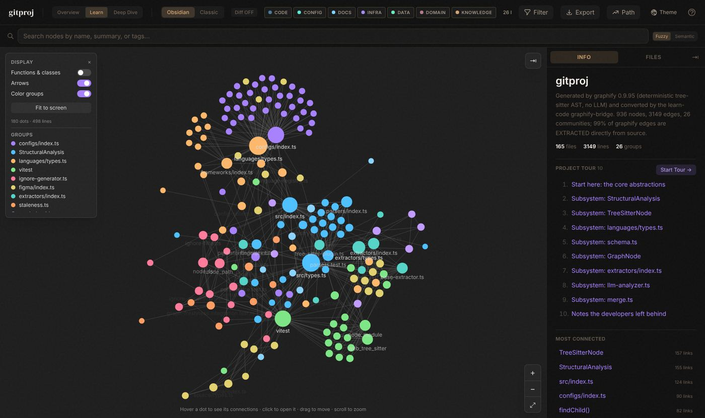
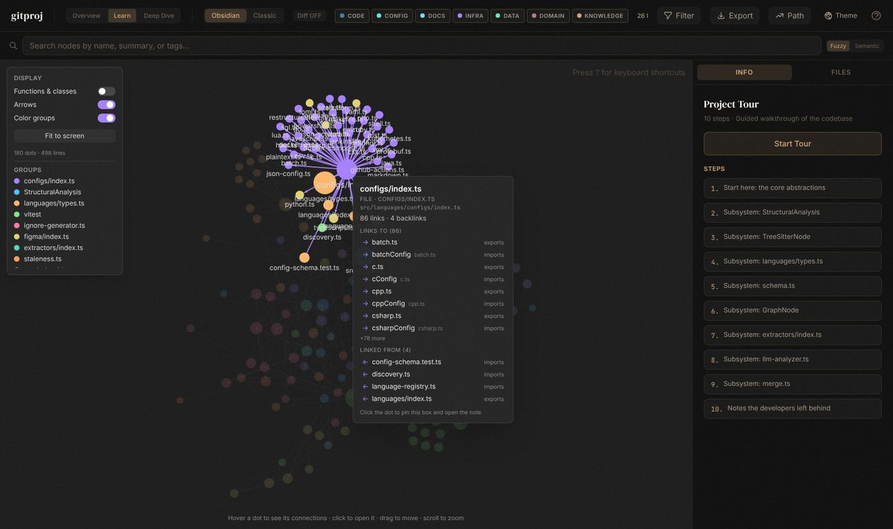
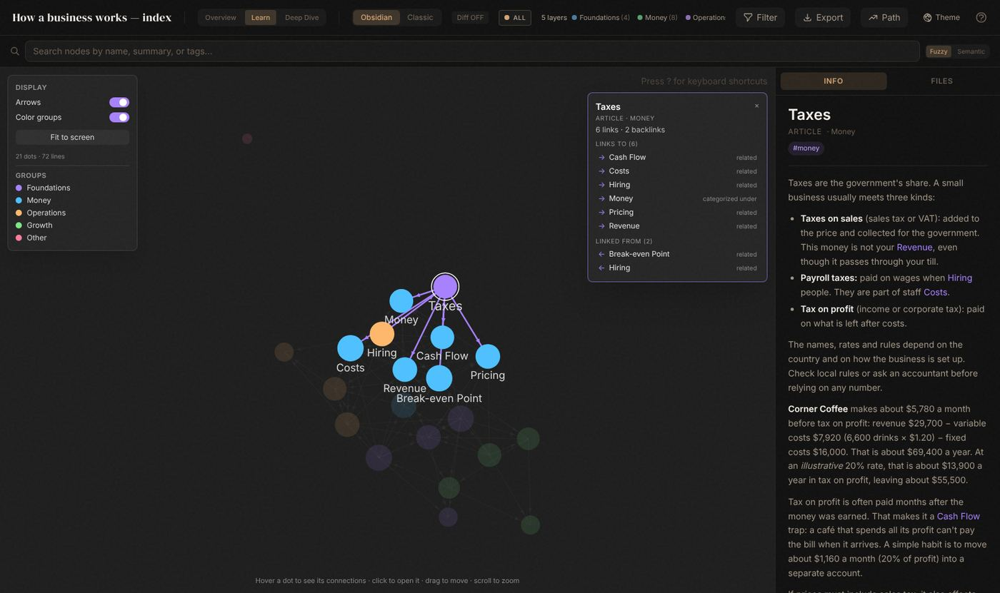
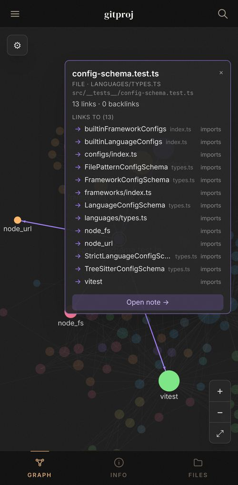
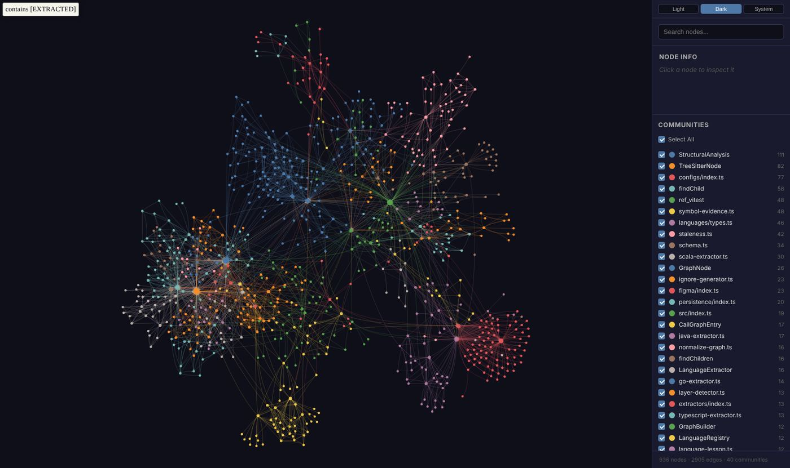

# Understand Anything with graphify

**Understand any codebase: an Obsidian-style map of every file and every connection,
explained in plain language.** It can also map a topic you're learning from scratch.



This repository combines two open-source tools and adds the pieces that connect them:

- **[graphify](graphify/)** reads a project and works out what connects to what. It needs
  no AI and no internet, and it's free.
- **[Understand Anything](understand-anything/)** shows that map as an interactive
  dashboard, with an Obsidian-style graph, notes, links and a guided tour.

It runs on your own computer; your files are not uploaded anywhere.

> 🤖 **Fastest way:** open your AI coding agent (Claude Code, Codex, Cursor, …) **in your
> codebase** and paste **[the one setup prompt](#-the-one-prompt-set-up-my-codebase)**. It
> maps your code, explains every file and every connection, and opens the dashboard.
> Nothing else to do. For **someone else's repository**, use
> **[this one](#-the-one-prompt-for-someone-elses-repository)** and paste their link.

---

## Contents

1. [What can I do with it?](#1-what-can-i-do-with-it)
2. [What you will see](#2-what-you-will-see)
3. [One-time setup](#3-one-time-setup)
4. [Try it in two minutes](#4-try-it-in-two-minutes)
5. [Way 1: understand an existing project](#5-way-1-understand-an-existing-project)
6. [Way 2: learn something from zero](#6-way-2-learn-something-from-zero)
7. [How to use the dashboard](#7-how-to-use-the-dashboard)
8. [Let an AI coding agent do it (copy-paste prompts)](#8-let-an-ai-coding-agent-do-it-copy-paste-prompts)
9. [Troubleshooting](#9-troubleshooting)
10. [For developers](#10-for-developers)
11. [Credits and licenses](#11-credits-and-licenses)

---

## 1. What can I do with it?

It is built mainly for **understanding codebases** (Way 1). Way 2 uses the same viewer to
learn a topic that has no code.

| | **Way 1: understand a codebase** (main use) | **Way 2: learn a topic from zero** |
|---|---|---|
| **Use it when…** | you have code (an app, a website, a library, a project you just joined) and want to understand how it works | you want to learn something with no code, such as how a business works, a subject for an exam, or a new field at work |
| **The map comes from…** | the project's files, read automatically | short notes you write as you learn, linked to each other |
| **It grows when…** | the project changes | you add a note |
| **"What should I learn next?"** | a guided tour: the most important parts first | a list of ideas you mentioned but haven't written about yet |
| **One command** | `bridge/run.sh <project folder>` | `learn-from-zero/learn.sh <notes folder>` |
| **Explanations** | from graphify alone: the structure, plus short generated descriptions. With [the one prompt](#-the-one-prompt-set-up-my-codebase), your AI agent writes plain-language explanations of every file and every connection | your own notes |

Both ways open the same viewer, so once you know one, you know both.

You don't need to be a programmer. You will type a few commands into a terminal, and each
one is written out below, ready to copy and paste.

---

## 2. What you will see

**Hover over a dot:** it and everything it's connected to light up, and a box tells you
what it links to and what links to it.



**Click a dot:** the box stays open, and the sidebar shows it as a note, with its text,
clickable links, and **Backlinks** (everything that points to it).



<table>
<tr>
<td width="34%"></td>
<td>

**It works on phones too.** Tap a dot to see its connections, then **Open note**.

**And a second view.** graphify's own interactive map opens next to the dashboard,
together with a written report of the most important parts of the project.



</td>
</tr>
</table>

---

## 3. One-time setup

You need five free tools. You install them once.

| Tool | What it's for | Check it's installed (paste into a terminal) | You need |
|---|---|---|---|
| **Git** | downloads this repository | `git --version` | any version |
| **Node.js** | runs the dashboard | `node --version` | 22 or newer |
| **pnpm** | installs the dashboard's parts | `pnpm --version` | 10 or newer |
| **uv** | runs graphify and installs Python for it | `uv --version` | any version |
| **Python** | runs the notes tools | `python3 --version` | 3.10 or newer |

> **What's a terminal?** It's the app where you type commands.
> **Mac:** open *Terminal* (press ⌘ Space and type "Terminal").
> **Linux:** open *Terminal*.
> **Windows:** see the Windows section below.

### Mac

1. Install [Homebrew](https://brew.sh) if you don't have it: copy the one-line command from
   its homepage into Terminal.
2. Install the tools:
   ```bash
   brew install git node uv python
   ```
   ```bash
   npm install -g pnpm
   ```

### Linux (Ubuntu / Debian)

```bash
sudo apt update && sudo apt install -y git curl python3
```
```bash
curl -LsSf https://astral.sh/uv/install.sh | sh
```

For Node.js 22 or newer, use the installer at [nodejs.org](https://nodejs.org) (choose "LTS"),
or [nvm](https://github.com/nvm-sh/nvm). Then:
```bash
npm install -g pnpm
```

Close the terminal and open a new one, so it notices the new tools.

### Windows

The scripts in this repository are written for Mac and Linux. On Windows, use **WSL**, a
Linux system built into Windows:

1. Open **PowerShell as Administrator** and run `wsl --install`, then restart your computer.
2. Open **Ubuntu** from the Start menu and follow the **Linux** steps above.

> This repository has been tested on Linux. Mac should work the same way. Windows has only
> been considered through WSL, not tested natively.

---

## 4. Try it in two minutes

**Step 1. Download the repository:**
```bash
git clone https://github.com/Okaytu/Understand-Anything-with-graphify.git
```
```bash
cd Understand-Anything-with-graphify
```

> No Git? On the GitHub page, click **Code → Download ZIP**, unzip it, and open a terminal in
> that folder. Everything below still works, except the parts about history and updates.

**Step 2. Map some real code.** This example maps the core of Understand Anything itself
(165 files):
```bash
bridge/run.sh understand-anything/understand-anything-plugin/packages/core/src
```
To map **your own code** instead, give the path to your project:
```bash
bridge/run.sh /path/to/your/project
```

The **first run takes a few minutes**, because it downloads what the dashboard and graphify
need. Later runs take seconds.

> Prefer a non-code example? `learn-from-zero/learn.sh learn-from-zero/examples/how-a-business-works`
> opens 16 linked notes about how a small café makes money (Way 2).

**Step 3. Open the link.** When it's ready, the terminal shows a line like this:
```
🔑  Dashboard URL: http://127.0.0.1:5173/?token=3f9a…
```
Copy that **whole** link, including the `?token=…` part, into your web browser.
graphify's view is at `http://127.0.0.1:5174/graph.html`.

**Step 4. Stop it when you're done** by pressing **Ctrl + C** in the terminal.

---

## 5. Way 1: understand an existing project

Point it at any folder of code on your computer:

```bash
bridge/run.sh /path/to/the/project
```

For example, to explore graphify itself:
```bash
bridge/run.sh graphify
```

### Someone else's repository

To see how another project is built, give the link instead of a folder:
```bash
bridge/run.sh https://github.com/owner/repo
```
Shorter, for GitHub:
```bash
bridge/run.sh owner/repo
```
Only one part of a big repository (copy the folder's link from GitHub):
```bash
bridge/run.sh https://github.com/owner/repo/tree/main/packages/web
```

- It downloads the **latest version only** (no history, so it's quick) to
  `~/understand-repos/<site>/<owner>/<repo>`, and prints that path. Running it again
  updates the same copy. Other git links work too, and `--branch name` picks a branch.
- **Their code is only read, never run or installed.** graphify parses the files as text.
- graphify's output is hidden from that copy's git, so nothing shows up as a change.
- To also get **every file and connection explained**, use
  [the one prompt for someone else's repository](#-the-one-prompt-for-someone-elses-repository).
- Private repositories work if your computer can already download them with `git clone`
  (for example, if you're logged in with GitHub's `gh` tool).

What happens:
1. **graphify reads the project.** It finds every file, function and class, and what
   uses what. This happens on your computer, with no AI and no internet needed.
2. **The result is converted and checked** so the dashboard can show it.
3. **Both viewers open.** Open the 🔑 link from the terminal, as in step 3 above.

**Want every file and connection explained in plain language?** Let your AI coding agent
write the explanations: paste [the one setup prompt](#-the-one-prompt-set-up-my-codebase),
or run the `bridge/enrich.py` loop yourself (see [`bridge/README.md`](bridge/README.md)).
Without it you still get the full map, with short descriptions generated from the structure.

**A good way to learn a project:**
1. Read **`graphify-out/GRAPH_REPORT.md`** inside the project. It lists the handful of
   parts everything else depends on.
2. In the dashboard sidebar, click **Start Tour →**. It walks through the most important
   parts first.
3. Hover over the big dots: bigger means more connected, and usually more important.
4. Click a file and press **Open code** to read the real code.
5. Write down what you learned as notes (Way 2). That's how it sticks.

> **Tip:** if the project uses Git, add the line `graphify-out/` to its `.gitignore` file.
> Otherwise the dashboard shows a "working-tree changes" warning about graphify's own output
> files. The script prints a reminder if this is needed.

More detail: [`bridge/README.md`](bridge/README.md).

---

## 6. Way 2: learn something from zero

Here you build the map yourself, one idea at a time. Each idea is a short note, and notes
link to each other.

**Step 1. Create a new notes folder** for your topic:
```bash
python3 learn-from-zero/learn.py init ~/learning/restaurants "How restaurants work"
```

**Step 2. Add what you learn.** Each note is one idea, with links to related ideas:
```bash
python3 learn-from-zero/learn.py new ~/learning/restaurants "Food Cost" --category Money --summary "what the ingredients of a dish cost" --link "Menu Pricing" --link "Suppliers"
```
This creates the file `wiki/Food Cost.md`. Open it in any text editor and write your
explanation. Mentioning another idea in double square brackets, like `[[Suppliers]]`, makes
a link.

**Step 3. Ask what to learn next.** This lists the ideas you linked but haven't written yet:
```bash
python3 learn-from-zero/learn.py next ~/learning/restaurants
```

**Step 4. See your map:**
```bash
learn-from-zero/learn.sh ~/learning/restaurants
```

Run it again after every few notes and watch the map grow.

> **Using Obsidian?** A notes folder made this way is plain Markdown with `[[links]]`, so
> you can also open it as an Obsidian vault and write your notes there. The two work
> side by side.

**What a good note looks like** (from the example):
```markdown
# Gross Margin

Gross margin is what is left from each sale after its variable [[Costs]]:
gross margin = price − variable cost per unit.

**Corner Coffee:** $4.50 − $1.20 = $3.30 per drink, a 73% gross margin.
```
Write one idea per note, in plain words, with a concrete example and links to related ideas.

More detail: [`learn-from-zero/README.md`](learn-from-zero/README.md).

---

## 7. How to use the dashboard

| I want to… | Do this |
|---|---|
| See what something connects to | **Hover** over its dot |
| Read about it | **Click** the dot. Its note opens in the sidebar |
| Jump to a related item | Click a name in the box or under **Links / Backlinks** |
| Go back | **← Back** at the top of the note |
| Move around | **Drag** the background; **scroll** to zoom; or use the **+ / − / ⤢** buttons |
| Move a dot | **Drag** the dot |
| Find something | Type in the **search bar** at the top; matches light up |
| Take the guided tour | **Start Tour →** in the sidebar |
| See functions and classes, not only files | Settings (⚙, top left) → **Functions & classes** |
| Give the graph more room | **⇥** (top right) hides the sidebar |
| Read the actual code | **Open code** in a file's note |
| Use the original layout | **Classic** in the header (on phones, in the ☰ menu) |
| Change colours | **Theme** in the header |

On a phone: tap a dot to see its connections, then tap **Open note**. Use **Graph / Info /
Files** at the bottom to switch screens.

---

## 8. Let an AI coding agent do it (copy-paste prompts)

If you use an AI coding agent such as **Claude Code**, **Codex**, **Cursor**, **GitHub
Copilot (agent mode)** or **Gemini CLI**, it can do every step in this README for you.

**How:** open a prompt below, click the **copy** button in the top-right corner of its box
(on a phone, tap and hold), paste it into your agent, replace anything in
`<<DOUBLE ANGLE BRACKETS>>` with your own details, and press Enter. The agent gets the repo,
checks your tools (asking before it installs anything), runs the commands, checks the
result, and explains it in plain language. It never edits your own project's files, and it
never commits or pushes by itself.

### ⭐ The one prompt: set up my codebase

Open your coding agent **inside your own project folder**, paste this, and wait. It maps
every file with graphify, then **your agent reads your code and explains every file and
every connection** in plain language (the Understand-Anything way), and opens the
dashboard. No other prompt is needed.

<details open>
<summary><b>Copy this prompt</b></summary>

```text
Set up "Understand Anything with graphify" (https://github.com/Okaytu/Understand-Anything-with-graphify)
for THIS codebase (the current folder), so its interactive dashboard maps every file and
explains every connection in plain language. Do every step without asking me, except before
installing software system-wide. Tell me what you're doing in short, plain sentences.

A. Get the tool
1. If ~/Understand-Anything-with-graphify exists, run
   `git -C ~/Understand-Anything-with-graphify pull --ff-only`; otherwise clone the repository
   there. Below, TOOL means that folder and PROJECT means this codebase (use absolute paths).
2. Check git, node (22 or newer), pnpm (10 or newer), uv and python3 (3.10 or newer).
   TOOL/README.md section 3 shows how to install them. If one is missing, tell me which one
   and ask before installing it.

B. Map the code (graphify, no AI)
3. If PROJECT is a git repository, make sure its .gitignore contains the line `graphify-out/`
   (create the file if needed). Change nothing else in PROJECT.
4. Run `TOOL/bridge/run.sh "PROJECT" --view none`. It must print a line starting with `valid:`.
   The first run downloads dependencies and can take a few minutes. If it stops because a
   knowledge graph made by /understand already exists, ask me before adding --force.

C. Explain everything (you write the explanations, using as few tokens as possible)
5. Run `python3 TOOL/bridge/enrich.py estimate "PROJECT"` and tell me its result in one line
   (files to explain, tokens, cost per model). By default it skips tests, docs and generated
   files. If I asked for them, add `--include-tests` or `--include-docs`; to explain only one
   part, add `--only <folder>`. Then run `python3 TOOL/bridge/enrich.py export "PROJECT"` with
   the same flags. It writes task files to PROJECT/.ua/enrich/: batch-NNN.json (files, their
   connections, and a short "digest" of each file) and project.json (overview, groups, tour).
6. For each task file: follow its "instructions" and write valid JSON to its "answer_file".
   Work from the digests; open a source file only when its digest isn't enough. Keep it short:
   - every file: 2 or 3 plain sentences;
   - every connection: ONE sentence on WHY it exists (its purpose, not just "it imports it");
   - every listed key symbol: one sentence;
   - for project.json: the overview, a meaningful name and description for every group, and
     a 6 to 12 step tour.
   Base everything on the actual code. Never invent.
   To save tokens: if you can start subagents (in Claude Code, the Task/Agent tool), give each
   task file to its own subagent, on a cheaper model such as Sonnet or Haiku when you can
   choose one, up to 4 at a time, with this instruction: "Read <task file>, follow its
   instructions, write its answer_file, then reply only: done". Don't read the task files
   yourself. Without subagents, do the task files one by one.
7. Run `python3 TOOL/bridge/enrich.py apply "PROJECT"`. It must print `valid:`. If it reports
   rejected entries, correct them and apply again.
8. Repeat steps 5 to 7 until `python3 TOOL/bridge/enrich.py status "PROJECT" --check` prints
   COMPLETE and exits with 0. A big codebase needs many batches: keep going until it is
   complete, and after each round tell me the progress (e.g. "120/340 files, 410/1200
   connections").

D. Open it
9. Start the viewers in the background: `TOOL/bridge/serve.sh "PROJECT"`. Give me the full
   `🔑 Dashboard URL` link, including `?token=...`, and http://127.0.0.1:5174/graph.html.
   If you can't keep a background process running, give me that command to run myself.
10. Finish with:
    - what the project is, in 3 sentences;
    - its main groups;
    - which file to start reading;
    - how to refresh after code changes: run steps 4 to 8 again. Existing explanations are
      kept, and only new or changed files need explaining.

Rules: never edit PROJECT's source files. The only things you add to PROJECT are graphify-out/,
.ua/ (its .ua/enrichments.json holds your explanations) and the .gitignore line. Don't commit
or push anything. If a step fails, read the error and the "Troubleshooting" table in
TOOL/README.md, fix what you safely can, and continue.
```

</details>

**Good to know:** the explaining in steps 5 to 8 uses your agent's own AI. graphify's map
(step 4) costs nothing. To keep the AI part small, the agent reads a short digest of each file
(imports, signatures and doc comments) instead of the whole file, skips tests, docs and
generated files, writes one sentence per connection, and hands each batch to a cheaper
subagent. Step 5 shows the estimate first; to check it yourself, run
`python3 bridge/enrich.py estimate /path/to/project`. As a rough guide, a project with about
150 source files costs around $1.50 to $2.50 on Opus and about half that on Sonnet.
Explanations are saved in `.ua/enrichments.json` in your project. Keep that file and
a later refresh only explains what changed.

### ⭐ The one prompt for someone else's repository

Want to understand a project that isn't yours? Open your coding agent **anywhere**, paste
this, and replace `<<REPOSITORY LINK>>` with the repository's link (for example
`https://github.com/owner/repo`, or a link to one of its folders).

<details open>
<summary><b>Copy this prompt</b></summary>

```text
Use "Understand Anything with graphify" (https://github.com/Okaytu/Understand-Anything-with-graphify)
to help me understand someone else's repository: <<REPOSITORY LINK>>
Map every file, explain every connection in plain language, and open the interactive
dashboard. Do every step without asking me, except before installing software system-wide.
Tell me what you're doing in short, plain sentences.

A. Get the tool
1. If ~/Understand-Anything-with-graphify exists, run
   `git -C ~/Understand-Anything-with-graphify pull --ff-only`; otherwise clone the repository
   there. Below, TOOL means that folder (use its absolute path).
2. Check git, node (22 or newer), pnpm (10 or newer), uv and python3 (3.10 or newer).
   TOOL/README.md section 3 shows how to install them. If one is missing, tell me which one
   and ask before installing it.

B. Download and map the repository (graphify, no AI)
3. Run `TOOL/bridge/run.sh "<<REPOSITORY LINK>>" --view none`. This downloads the latest
   version of the repository to ~/understand-repos/... and maps it. It must print a line
   starting with `valid:`. Its "Your copy is at:" line gives the folder: below, PROJECT
   means that path.
   Never run, build or install the downloaded project's own code: only read it.

C. Explain everything (you write the explanations, using as few tokens as possible)
4. Run `python3 TOOL/bridge/enrich.py estimate "PROJECT"` and tell me its result in one line
   (files to explain, tokens, cost per model). By default it skips tests, docs and generated
   files. If I asked for them, add `--include-tests` or `--include-docs`; to explain only one
   part, add `--only <folder>`. Then run `python3 TOOL/bridge/enrich.py export "PROJECT"` with
   the same flags. It writes task files to PROJECT/.ua/enrich/: batch-NNN.json (files, their
   connections, and a short "digest" of each file) and project.json (overview, groups, tour).
5. For each task file: follow its "instructions" and write valid JSON to its "answer_file".
   Work from the digests; open a source file only when its digest isn't enough. Keep it short:
   - every file: 2 or 3 plain sentences;
   - every connection: ONE sentence on WHY it exists (its purpose, not just "it imports it");
   - every listed key symbol: one sentence;
   - for project.json: the overview, a meaningful name and description for every group, and
     a 6 to 12 step tour.
   Base everything on the actual code and the repository's README. Never invent.
   To save tokens: if you can start subagents (in Claude Code, the Task/Agent tool), give each
   task file to its own subagent, on a cheaper model such as Sonnet or Haiku when you can
   choose one, up to 4 at a time, with this instruction: "Read <task file>, follow its
   instructions, write its answer_file, then reply only: done". Don't read the task files
   yourself. Without subagents, do the task files one by one.
6. Run `python3 TOOL/bridge/enrich.py apply "PROJECT"`. It must print `valid:`. If it reports
   rejected entries, correct them and apply again.
7. Repeat steps 4 to 6 until `python3 TOOL/bridge/enrich.py status "PROJECT" --check` prints
   COMPLETE and exits with 0. A big repository needs many batches: keep going until it is
   complete, and after each round tell me the progress (e.g. "120/340 files, 410/1200
   connections").

D. Open it
8. Start the viewers in the background: `TOOL/bridge/serve.sh "PROJECT"`. Give me the full
   `🔑 Dashboard URL` link, including `?token=...`, and http://127.0.0.1:5174/graph.html.
   If you can't keep a background process running, give me that command to run myself.
9. Finish with:
   - what the project does and who it's for, in 3 sentences;
   - its main groups;
   - its tech stack (from the files, not guesses);
   - which 5 files to read first, in order;
   - how to refresh later: run step 3 again (it updates my copy), then steps 4 to 7.
     Existing explanations are kept, and only new or changed files need explaining.

Rules: don't change any file in the downloaded repository except the generated graphify-out/
and .ua/ folders. Don't commit or push anything anywhere. If a step fails, read the error and
the "Troubleshooting" table in TOOL/README.md, fix what you safely can, and continue.
```

</details>

### More prompts for specific jobs

| # | Prompt | Use it when |
|---|---|---|
| 1 | Set up and show me the example | the first time |
| 2 | Help me understand my project | you have code you want to understand |
| 3 | Start learning a topic from zero | you want to learn something with no code |
| 4 | Grow my notes | you already have a notes folder |
| 5 | Teach me step by step | you want a guided lesson with questions |
| 6 | Something isn't working | a command failed |
| 7 | Update from upstream (developers) | you want the latest graphify / Understand Anything |

<details>
<summary><b>Prompt 1: Set up and show me the example</b></summary>

```text
Help me use the GitHub repository "Understand Anything with graphify"
(https://github.com/Okaytu/Understand-Anything-with-graphify). It turns codebases into an
interactive Obsidian-style graph dashboard. Set it up and show me the built-in code example.
I may not be a programmer: explain each step in one plain sentence.

1. Get the repository. If the current folder already contains both `bridge/run.sh` and
   `learn-from-zero/learn.sh`, use it. Otherwise run
   `git clone https://github.com/Okaytu/Understand-Anything-with-graphify.git ~/Understand-Anything-with-graphify`
   and work inside that folder for everything below.
2. Check my tools without changing anything that already works: `git --version`,
   `node --version` (needs 22 or newer), `pnpm --version` (10 or newer), `uv --version`,
   `python3 --version` (3.10 or newer). If something is missing or too old, tell me which
   one, show me the install command for my operating system from section
   "3. One-time setup" of README.md, and ask me before installing anything.
3. Map the example code (the core of Understand Anything itself, 165 files) without
   starting any servers:
   `bridge/run.sh understand-anything/understand-anything-plugin/packages/core/src --view none`
   The first run downloads dependencies and can take a few minutes. It has succeeded only
   if the output contains a line starting with `valid:`.
4. Start the viewers as a background process:
   `bridge/serve.sh understand-anything/understand-anything-plugin/packages/core/src`
   Wait for the line that starts with `🔑  Dashboard URL:` and give me that full link,
   including the `?token=...` part. Also give me http://127.0.0.1:5174/graph.html
   (graphify's view, which needs internet in the browser).
5. In 3 short bullet points, tell me what to click first. Then tell me how to stop the
   servers.

Rules: do not commit, push, or edit any file tracked by git (generated folders like `.ua/`
and `graphify-out/` are fine). If a step fails, read the error, check the "Troubleshooting"
table in README.md, fix what you safely can, and tell me plainly what happened. If you
cannot keep a process running in the background, stop after step 3 and give me the exact
command from step 4 to run in my own terminal.
```

</details>

<details>
<summary><b>Prompt 2: Help me understand my project</b></summary>

Replace `<<PATH TO MY PROJECT>>` with the folder of the code you want to understand,
e.g. `~/code/my-app`.

```text
Use the repository "Understand Anything with graphify"
(https://github.com/Okaytu/Understand-Anything-with-graphify) to help me understand the code
project in this folder: <<PATH TO MY PROJECT>>
Explain things for a beginner: plain words, short sentences, no unexplained jargon.

1. Get the repository. If the current folder contains `bridge/run.sh`, use it. Otherwise
   clone it to ~/Understand-Anything-with-graphify (unless it is already there) and work
   from that folder. Check git, Node.js 22+, pnpm 10+, uv and Python 3.10+ as described in
   README.md section 3. Ask me before installing anything.
2. Map my project without starting servers: `bridge/run.sh "<<PATH TO MY PROJECT>>" --view none`
   It succeeded only if the output contains a line starting with `valid:`. If it says the
   project already has a knowledge graph that this bridge did not create, stop and ask me
   before using `--force`.
3. Read `<<PATH TO MY PROJECT>>/graphify-out/GRAPH_REPORT.md`, and the `tour` and `layers`
   in `<<PATH TO MY PROJECT>>/.ua/knowledge-graph.json` (or `.understand-anything/` if that
   folder exists).
4. Check before you claim. For anything important you are unsure about, ask graphify from
   inside the repository's `graphify` folder, for example:
   `cd graphify && uv run graphify explain "SomeName" --graph "<<PATH TO MY PROJECT>>/graphify-out/graph.json"`
   or `uv run graphify path "A" "B" --graph ...`. Read the actual source files too.
   Don't state anything you didn't check.
5. Write me a guide with these sections:
   - What this project does, in 3 sentences.
   - The 5 to 8 main parts: what each does and its key files.
   - The core building blocks: the most-connected classes or functions, with file paths,
     and why everything depends on them.
   - Reading order: 6 to 10 files to read, in order, with one line each on what to look for.
   - 3 surprising or important connections between parts.
   - Words I need to know: short definitions of terms the code uses.
6. Start the viewers in the background with `bridge/run.sh "<<PATH TO MY PROJECT>>"` and give
   me the full `🔑 Dashboard URL` link, including `?token=...`. If you cannot keep a
   process running, give me the command instead.
7. Ask me if I want this guide saved as notes in a learning wiki
   (`learn-from-zero/learn.py init` / `new`), so I can grow it as I learn.

Rules: never edit, move or delete my project's own files. The only things this should add
to my project are the generated `graphify-out/` and `.ua/` folders. If my project is a git
repository and `graphify-out/` isn't in its .gitignore, suggest adding it, but don't do it
without asking. Don't commit or push anything.
```

</details>

<details>
<summary><b>Prompt 3: Start learning a topic from zero</b></summary>

Replace the three `<<...>>` lines with your own answers.

```text
Use the repository "Understand Anything with graphify"
(https://github.com/Okaytu/Understand-Anything-with-graphify) to start a learning wiki for me:
a folder of short, linked notes that becomes an interactive knowledge graph.

Topic: <<WHAT I WANT TO LEARN, e.g. "how restaurants make money">>
My level: <<e.g. "complete beginner">>
My goal: <<e.g. "understand it well enough to plan a small food business">>

1. Get the repository. If the current folder contains `learn-from-zero/learn.py`, use it.
   Otherwise clone it to ~/Understand-Anything-with-graphify (unless it is already there)
   and work from there. Check Node.js 22+, pnpm 10+, uv and Python 3.10+ as described in
   README.md section 3, and ask me before installing anything.
2. Learn the house style first. Read `learn-from-zero/README.md`,
   `learn-from-zero/template/CLAUDE.md` and three notes from
   `learn-from-zero/examples/how-a-business-works/wiki/`.
3. Create the wiki: `python3 learn-from-zero/learn.py init ~/learning/<short-topic-name> "<Topic>"`.
   The wiki's own CLAUDE.md lists the rules for notes. Follow them.
4. Fill in `wiki/Start Here.md` with my question, level and goal.
5. Write the first 8 to 12 notes, foundations first. For each note, run
   `python3 learn-from-zero/learn.py new <wiki> "<Title>" --category "<Category>" --summary "<one line>"`,
   then write its content:
   - one idea per note: a plain-language definition first, then details;
   - one concrete running example (like the café "Corner Coffee" in the example) used
     across all the notes, with numbers that agree from note to note;
   - [[links]] to every related idea, including some I haven't written yet;
   - categories in wiki/index.md ordered from foundations to advanced (the order becomes
     the tour).
   Say clearly when something depends on country, law or date. Don't invent facts or
   sources. If you used real sources, list them in raw/sources.md.
6. Check your work: `python3 learn-from-zero/learn.py next <wiki>` lists the gaps.
   `learn-from-zero/learn.sh <wiki> --view none` must print a line starting with `valid:`.
7. Start the viewers in the background with `learn-from-zero/learn.sh <wiki>` and give me
   the full `🔑 Dashboard URL` link, including `?token=...`. If you cannot keep a
   process running, give me the command instead.
8. Finish with: the notes you wrote, in one line each; the top 5 "next to learn" gaps; and
   one question for me to think about before the next session.

Rules: only create files inside the new wiki folder. Don't commit or push anything.
```

</details>

<details>
<summary><b>Prompt 4: Grow my notes</b></summary>

```text
I have a learning wiki made with "Understand Anything with graphify"
(https://github.com/Okaytu/Understand-Anything-with-graphify) at: <<PATH TO MY NOTES FOLDER>>
Help it grow by <<NUMBER, e.g. 5>> notes.

1. Find the repository (a folder containing `learn-from-zero/learn.py`), or clone it to
   ~/Understand-Anything-with-graphify.
2. Read my wiki's CLAUDE.md, wiki/index.md, wiki/log.md and the existing notes, so you match
   my style, my running example and my numbers.
3. Run `python3 learn-from-zero/learn.py next "<<PATH TO MY NOTES FOLDER>>"` and take the
   most-linked gaps first.
4. For each new note, run `learn.py new` with the best-fitting existing category, then write
   it: plain definition, my running example with numbers that agree with the existing notes,
   and [[links]]. Where it's natural, add a [[link]] to the new note from 1 or 2 existing
   notes. Don't rewrite my existing text otherwise.
5. Re-check: `learn-from-zero/learn.sh "<<PATH TO MY NOTES FOLDER>>" --view none` must print
   a line starting with `valid:`. Run `learn.py next` again.
6. Tell me what you added, which existing notes you changed and why, any numbers you
   double-checked, and the new top gaps. Then offer to start the viewers.

Rules: only change files inside my notes folder. Flag anything that depends on country, law
or date. Don't invent sources. Don't commit or push anything.
```

</details>

<details>
<summary><b>Prompt 5: Teach me step by step</b></summary>

```text
Use the knowledge graph in <<PATH TO MY PROJECT OR NOTES FOLDER>>/.ua/knowledge-graph.json
(made with https://github.com/Okaytu/Understand-Anything-with-graphify) to teach me
interactively. If that file doesn't exist yet, create it first: use
`bridge/run.sh "<path>" --view none` for code, or `learn-from-zero/learn.sh "<path>" --view none`
for a notes folder, from the repository folder.

Walk me through the graph's `tour`, sorted by `order`, one step at a time:
- explain the step in plain language, in at most 8 sentences, using the summaries of the
  step's nodes (and the real source files or notes they point to);
- show me which parts it involves (names and file paths) so I can find them in the
  dashboard;
- ask me one question to check I understood it, then WAIT for my answer;
- if my answer is wrong or incomplete, explain the gap kindly and ask a simpler follow-up;
- only move on to the next step when I say "next".
At the end, summarise what I learned and suggest the 3 things to study next.
Don't change any files.
```

</details>

<details>
<summary><b>Prompt 6: Something isn't working</b></summary>

```text
I'm using the repository "Understand Anything with graphify"
(https://github.com/Okaytu/Understand-Anything-with-graphify) and this didn't work:

Command I ran: <<PASTE THE COMMAND>>
What happened: <<PASTE THE ERROR OR DESCRIBE IT>>

Please:
1. Find the repository folder (it contains bridge/run.sh) and re-run the command, adding
   `--view none` if it's run.sh or learn.sh, so we see the error without starting servers.
2. Check the "Troubleshooting" table in README.md and the tool versions it needs
   (Node.js 22+, pnpm 10+, uv, Python 3.10+).
3. Find the real cause from the actual output. Don't guess.
4. Fix it if the fix is safe and local, such as a missing dependency, file permissions,
   a port already in use, or a missing .gitignore entry. Ask me first before installing
   system-wide software, deleting anything, or using `--force`.
5. Re-run and show me that it now works: a line starting with `valid:`, or the
   `🔑 Dashboard URL`.
6. Explain in 2-3 plain sentences what was wrong and what you changed.
If the problem is a bug in this repository, say so and describe it. Don't commit or push
anything.
```

</details>

<details>
<summary><b>Prompt 7: Update from upstream (developers)</b></summary>

```text
In the repository "Understand Anything with graphify" (my clone of
https://github.com/Okaytu/Understand-Anything-with-graphify), pull the latest upstream
versions of both subprojects. Follow "History and upstream updates" in README.md:

1. Make sure the working tree is clean and create a new branch named
   `update-upstream-<today's date>`.
2. Add the remotes if they're missing (ua-upstream → https://github.com/Okaytu/Understand-Anything,
   graphify-upstream → https://github.com/Okaytu/graphify), then fetch `main` and `v8`.
3. Run `git subtree pull --prefix=understand-anything ua-upstream main` and
   `git subtree pull --prefix=graphify graphify-upstream v8`.
4. Resolve conflicts by keeping upstream's changes AND this repo's additions: the
   Obsidian graph style in understand-anything/understand-anything-plugin/packages/dashboard
   (App.tsx, store.ts, MobileLayout.tsx, MobileDrawer.tsx, locales/*, components/Obsidian*,
   utils/obsidian-graph*). Explain every conflict you resolve.
5. Verify, using the commands under "Running the tests" in README.md: the
   understand-anything tests, the dashboard build
   (`pnpm --filter @understand-anything/dashboard build`), the graphify tests, the bridge +
   learn-from-zero tests, and `bridge/run.sh graphify --view none`.
   graphify's tests that need DNS or a full git history may fail in sandboxes without
   them. Report them separately; don't hide failures.
6. Show me a summary of what changed upstream and the test results. Don't push or merge
   into main until I say so.
```

</details>

**Tips for specific agents**

- **Claude Code:** paste directly. It can keep the dashboard running in the background and
  give you the link. Understand Anything is also a Claude Code plugin: see
  [understand-anything/README.md](understand-anything/README.md) for the AI-powered
  `/understand` commands.
- **Codex and other sandboxed agents:** the first run needs internet to download
  dependencies. If the sandbox blocks network or local servers, allow them for this
  folder, or let the agent stop at the `--view none` step and run the printed command
  yourself.
- **Editor agents (Cursor, Copilot, …):** open the repository folder first, so the agent
  can see `README.md`, and run the prompts in agent mode, not plain chat. Plain chat can't
  run commands.

> These prompts use the commands documented in this README. Every command was run and
> checked; how closely each agent follows the prompts depends on the agent.

**AI-powered analysis (optional).** Everything in this README works **without AI**; the
prompts above only let an agent run the steps for you. If you use an AI coding assistant such as
[Claude Code](https://claude.com/claude-code), Understand Anything can also be installed as a
plugin that adds AI-written explanations:

- `/understand` on a project writes plain-English summaries, architecture layers and a teaching tour.
- `/understand-knowledge` on a notes folder finds hidden connections between your notes.

Installation for each assistant: [`understand-anything/README.md`](understand-anything/README.md).
To see how the AI version compares with graphify's free version on the same project, read
[`notes/03-side-by-side.md`](notes/03-side-by-side.md).

---

## 9. Troubleshooting

| Problem | Fix |
|---|---|
| `command not found: pnpm` (or `uv`, `node`) | That tool isn't installed, or the terminal was opened before installing it. Redo [setup](#3-one-time-setup), then open a new terminal. |
| `permission denied` when running a script | Run `chmod +x bridge/*.sh learn-from-zero/*.sh` once, then try again. |
| The page says **"Access Token Required"** | Use the full 🔑 link from the terminal, including `?token=…`. A new token is made each time you start it. |
| **"could not download …"** (someone else's repository) | Check the link opens in your browser. For a private repository, make sure `git clone <link>` works in your terminal first (log in to GitHub, e.g. with `gh auth login`). |
| **Port already in use** | Something else is using port 5173. Stop it, or add `--port 6000` to the command and use ports 6000 / 6001. |
| graphify's view (`graph.html`) is **blank** | It loads its drawing library from the internet, so it needs a connection. The dashboard works offline. |
| Orange **"working-tree changes"** banner | Add `graphify-out/` to the project's `.gitignore` (see the tip in [Way 1](#5-way-1-understand-an-existing-project)). |
| "**…already exists and was not created by this bridge**" | The project already has a map made by the AI version. Add `--force` to replace it. |
| The first run is slow | It's downloading dependencies once. Later runs are fast. |
| Something else | Run the same command with `--view none`: it only builds and checks, and prints what went wrong. |

Only open the dashboard links yourself. The servers listen on your own computer only
(`127.0.0.1`) and are not reachable from other devices.

---

## 10. For developers

<details>
<summary><b>Repository layout</b></summary>

```
├── understand-anything/   full Understand Anything project (git subtree, MIT)
├── graphify/              full graphify project (git subtree, Apache-2.0)
├── bridge/                Way 1: graphify → Understand-Anything converter, runner,
│                          viewer server, graph comparison
├── learn-from-zero/       Way 2: notes template, worked example, learn.py / learn.sh
├── notes/                 study guide, architecture notes, comparison report
├── docs/images/           screenshots used in this README
└── .github/workflows/     CI for everything above
```

Additions inside `understand-anything/`: the Obsidian graph style
(`packages/dashboard/src/components/Obsidian*.tsx`, `src/utils/obsidian-graph.ts`). Upstream
Understand Anything does not have it.
</details>

<details>
<summary><b>Commands</b></summary>

```bash
bridge/run.sh <folder | repo-url | owner/repo> [--view both|ua|graphify|none] [--port N] [--force] [--branch B]
learn-from-zero/learn.sh <notes> [--view both|ua|graphify|none] [--port N] [--force]
bridge/serve.sh <dir> [--view both|ua|graphify] [--port N]      # viewers only, no rebuild
python3 bridge/enrich.py {estimate|status|export|apply} <project> # agent-written explanations
python3 bridge/compare_graphs.py <understand.json> <bridge.json> --project <src>
bridge/compare_demo.sh                                            # regenerate notes/comparison-report.md
python3 learn-from-zero/learn.py {init|new|next|build} …
```
</details>

<details>
<summary><b>Running the tests</b></summary>

```bash
cd understand-anything && pnpm install && pnpm --filter @understand-anything/core build && pnpm --filter @understand-anything/skill build && pnpm test
```
```bash
cd graphify && uv sync --all-extras && uv run pytest tests/ -q
```
```bash
cd graphify && uv run pytest ../bridge/tests ../learn-from-zero/tests -q
```

Run graphify commands from inside `graphify/` or from the target project, not from the
repository root: there, the `graphify/` folder hides the installed package. The scripts
handle this for you.

CI ([`.github/workflows/ci.yml`](.github/workflows/ci.yml)) runs all three suites. The graphify
job needs the full git history (`fetch-depth: 0`), because some tests read files from
older commits.
</details>

<details>
<summary><b>History and upstream updates</b></summary>

Both projects were imported with `git subtree add`, so their full commit history is
here. `git blame` follows lines into the original history. A path-limited `git log` stops
at the import commit, so to see a file's history, log the upstream branch:

```bash
git remote add ua-upstream https://github.com/Okaytu/Understand-Anything
git remote add graphify-upstream https://github.com/Okaytu/graphify
git fetch ua-upstream main && git fetch graphify-upstream v8
git log graphify-upstream/v8 -- graphify/build.py
```

To pull updates:
```bash
git subtree pull --prefix=understand-anything ua-upstream main
git subtree pull --prefix=graphify graphify-upstream v8
```
Expect conflicts in the dashboard files this repo changed (`App.tsx`, `store.ts`,
`MobileLayout.tsx`, `MobileDrawer.tsx`, `locales/*`).
</details>

<details>
<summary><b>Study notes</b></summary>

[`notes/README.md`](notes/README.md) is a study guide for both ways of learning, with a reading
order and exercises. It also links architecture notes on [graphify](notes/01-graphify.md)
and [Understand Anything](notes/02-understand-anything.md), and a
[comparison of the two on the same code](notes/03-side-by-side.md).
</details>

---

## 11. Credits and licenses

- **Understand Anything** by Yuxiang Lin and contributors: MIT,
  see [`understand-anything/LICENSE`](understand-anything/LICENSE).
- **graphify** by Graphify Labs and contributors: Apache-2.0,
  see [`graphify/LICENSE`](graphify/LICENSE) and [`graphify/NOTICE`](graphify/NOTICE).

Each project keeps its own license; this repository does not relicense either one. The
café numbers in the business example are made up for learning.
